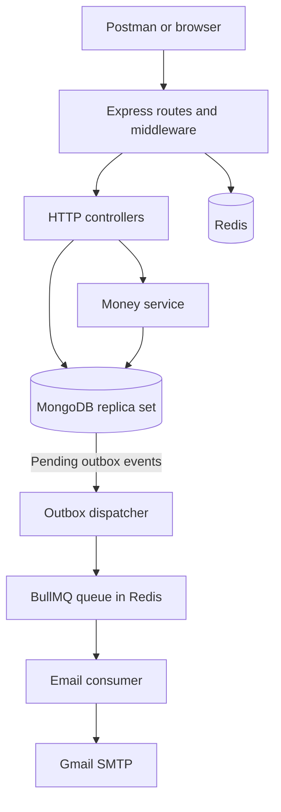
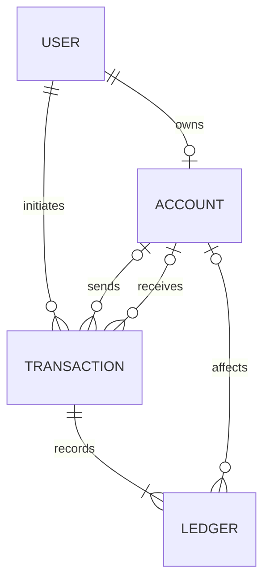

# Backend Ledger

A REST API for a simulated wallet built with Node.js, Express, MongoDB, Redis, and BullMQ. Each user starts with a ₹0 balance. The project demonstrates how to record money movements, handle payment retries, and send email notifications from a separate worker.

## What the system provides

- **Accounts and authentication.** Registration creates a user and wallet in one MongoDB transaction. Login sets a one-day JWT cookie. Logout revokes the token in Redis.
- **Wallet operations.** Users can transfer whole rupees by receiver email. A development setting enables simulated deposits and withdrawals.
- **Payment receipts.** Each money movement carries an idempotency key. Clients can use that key to retrieve a receipt after losing an HTTP response.
- **Ledger history.** Each movement builds a debit and a credit. Users can page through their own transactions and see the counterparty’s name and email.
- **Background notifications.** With email enabled, the API records a notification event in MongoDB. A separate worker dispatches it through BullMQ and sends it using Gmail OAuth2.

> **Current payment status in v2.0.0:** The money service calls `Ledger.create(postings, { session })` with two entries. The locked Mongoose version requires `ordered: true` for this operation. New deposits, withdrawals, and transfers that reach this write abort before commit. The payment walkthrough below gives the expected results after changing the call to `await Ledger.create(postings, { session, ordered: true })`.

## Components

| Component | Main technology | Responsibility |
|---|---|---|
| HTTP API | Node.js 22, Express 5 | Routing, validation, authentication, and HTTP responses |
| Database | MongoDB 7 replica set, Mongoose 9 | Users, account balances, transaction receipts, ledger entries, and outbox events |
| Redis | Redis 7, ioredis | Rate limits, revoked sessions, and BullMQ jobs |
| Email worker | BullMQ, Nodemailer | Dispatch pending events and send email through Gmail OAuth2 |
| Authentication | bcryptjs, jsonwebtoken, cookie-parser | Password hashing, token verification, and login cookies |
| Operations | Docker Compose, Winston | Local services and structured application logs |

## Architecture



`server.js` starts the API. `worker.js` runs the outbox dispatcher and email consumer in a separate process. A payment can therefore record its notification in the same database transaction as its receipt, while the SMTP call happens later.

## Data model



| Model | What it stores |
|---|---|
| `User` | Name, normalized unique email, and password hash |
| `Account` | Owner, wallet balance, and account status. Each user can own one wallet. |
| `Transaction` | Initiator, operation, amount, sender or receiver, status, idempotency key, and request fingerprint. The initiator and key form a unique pair. |
| `Ledger` | Transaction ID, posting index, debit or credit, amount, and the wallet or clearing side. Wallet entries also record the resulting balance. |
| `Outbox` | Notification payload, unique event key, dispatch status, and lease expiry so a worker can claim pending work |

## Request lifecycles

### Money transfer

Suppose Asha has ₹1,000 and sends ₹200 to Ravi.

1. The API identifies Asha from her login cookie and reads the receiver email, amount, and idempotency key.
2. The money service looks for an existing receipt under **Asha’s user ID and that key**. A matching request returns the earlier receipt.
3. For a new payment, the service resolves both wallets. The debit checks that Asha’s account is active and has at least ₹200 in the same database update that subtracts the funds.
4. The service credits Ravi, creates a receipt, and builds two postings: a ₹200 debit for Asha and a ₹200 credit for Ravi.
5. The balance updates, receipt, postings, and optional email event share one MongoDB transaction. After a successful commit, Asha has ₹800 and Ravi’s balance has increased by ₹200.

### Idempotency and recovery

Use the `Idempotency-Key` HTTP header or the `idempotencyKey` field in the JSON body. If you send both, their values must match. Keys accept 8–100 letters, digits, dots, underscores, colons, or hyphens.

| Situation | Client behavior |
|---|---|
| The response was lost | Look up `GET /api/transactions/by-key/:key` using the sender’s session. Retry the original request with the same key if needed. |
| The same payment already committed | A matching retry returns the original transaction ID and `replayed: true`. |
| The amount, receiver, or operation changed | Reusing the key returns HTTP 422 with `IDEMPOTENCY_KEY_REUSED`. |
| The user intentionally starts another payment | Generate a new key for that payment. |

### Demo funding and ledger entries

A wallet-to-wallet transfer uses two customer accounts. A simulated deposit or withdrawal uses `DEMO_CLEARING` as the opposite side of the journal entry. Amounts are positive JSON integers in whole rupees. For example, send `200` rather than `"200"` or `200.50`.

### Sessions, history, and rate limits

- Login sets an `HttpOnly` cookie with `SameSite=Strict`. The cookie also uses `Secure` in production.
- Logout stores a hash of the verified token in Redis until the token expires, then clears the cookie.
- History is read directly from MongoDB and ordered by creation time and transaction ID. The default page size is 10 and the maximum is 50.
- Redis enforces per-IP sliding windows of 10 requests per 15 minutes for the auth route group and 100 per 15 minutes for the transaction route group.

## HTTP API

Base URL for local development: `http://localhost:3000`.

| Method | Endpoint | Purpose | Login required |
|---|---|---|---|
| `GET` | `/` | Project information | No |
| `GET` | `/health` | Check that the API process responds | No |
| `GET` | `/ready` | Check MongoDB and Redis readiness | No |
| `POST` | `/api/auth/register` | Create a user and wallet | No |
| `POST` | `/api/auth/login` | Set the login cookie | No |
| `POST` | `/api/auth/logout` | Revoke the current session | Yes |
| `GET` | `/api/users/profile` | View your profile and wallet balance | Yes |
| `POST` | `/api/transactions/deposit` | Add demo funds | Yes |
| `POST` | `/api/transactions/withdraw` | Withdraw demo funds | Yes |
| `POST` | `/api/transactions/transfer` | Transfer to another user by email | Yes |
| `GET` | `/api/transactions/history?page=1&limit=10` | View your transaction history | Yes |
| `GET` | `/api/transactions/by-key/:key` | Recover a receipt for your key | Yes |

Deposits and withdrawals also require `ENABLE_DEMO_FUNDING=true`.

## Error responses

Errors include a machine-readable code. For example, sending an amount as a string produces:

```json
{
  "success": false,
  "error": {
    "code": "INVALID_AMOUNT",
    "message": "amount must be a NUMBER (integer) between 1 and 1000000000"
  }
}
```

| HTTP status | Example code | Meaning |
|---|---|---|
| `400` | `INVALID_AMOUNT` | Amount validation failed |
| `401` | `INVALID_CREDENTIALS` | Login credentials were rejected |
| `403` | `DEMO_FUNDING_DISABLED` | Demo deposits and withdrawals are disabled |
| `404` | `TRANSACTION_NOT_FOUND` | No committed receipt was found for this user and key |
| `409` | `EMAIL_EXISTS` | The email is already registered |
| `422` | `IDEMPOTENCY_KEY_REUSED` | The key belongs to a different request |
| `429` | `RATE_LIMITED` | The request limit was reached |
| `503` | `TRANSACTION_OUTCOME_UNKNOWN` | Check the receipt and retry with the original key |

## Local setup

### Option 1 — Docker Compose

Install Docker Desktop or Docker Engine with Compose. Open a terminal in the project root, where `docker-compose.yml` and `package.json` are located. If you are reusing an existing database, read the [migration guide](docs/MIGRATION.md) first.

**1. Create your local environment file.**

Windows PowerShell:

```powershell
Copy-Item .env.example .env
```

macOS or Linux:

```bash
cp .env.example .env
```

**2. Configure `.env`.**

Set `JWT_SECRET` to a private random value of at least 32 characters. If Node.js is installed, generate one locally:

```bash
node -e "console.log(require('node:crypto').randomBytes(32).toString('hex'))"
```

For local wallet practice, set:

```env
ENABLE_DEMO_FUNDING=true
EMAIL_ENABLED=false
```

**3. Start the services.**

```bash
docker compose up --build -d
docker compose ps
```

Compose starts MongoDB, initializes a single-member replica set, starts Redis, and launches the API and worker. Open `http://localhost:3000/ready` and look for `{"ready":true}`.

To inspect startup logs:

```bash
docker compose logs --tail=80 api mongo-init
```

To stop the services while preserving the named data volumes:

```bash
docker compose down
```

### Option 2 — Run Node.js locally

Use Node.js 22 with a current patch release, a reachable MongoDB replica set, and Redis. The replica set must advertise a hostname your local Node process can resolve. Prepare `.env` as above, then run:

```bash
npm ci
npm run check
npm start
```

| Command | Purpose |
|---|---|
| `npm start` | Start the API |
| `npm run dev` | Start the API with automatic restarts |
| `npm run worker` | Start the background worker in a second terminal |
| `npm run check` | Check JavaScript syntax |
| `npm run indexes` | Inspect indexes in the configured MongoDB database |

## Try it with Postman

Use **Body → raw → JSON** for POST requests and keep the Postman cookie jar enabled.

### 1. Register and sign in

Send `POST /api/auth/register`:

```json
{
  "name": "Asha",
  "email": "asha@example.com",
  "password": "demo-pass-123"
}
```

Register a second user named Ravi with `ravi@example.com`. Then send `POST /api/auth/login` as Asha:

```json
{
  "email": "asha@example.com",
  "password": "demo-pass-123"
}
```

Call `GET /api/users/profile`. A new wallet starts at ₹0.

### 2. Verify a payment after the posting correction

With demo funding enabled, send `POST /api/transactions/deposit`:

```json
{
  "amount": 1000,
  "idempotencyKey": "deposit-asha-001"
}
```

Send `POST /api/transactions/transfer` and save the returned transaction ID:

```json
{
  "receiverEmail": "ravi@example.com",
  "amount": 200,
  "idempotencyKey": "transfer-asha-ravi-001"
}
```

Send the **same transfer again**. The expected response contains the same transaction ID and `replayed: true`. Asha’s balance should still be ₹800. Using Ravi’s own session, his balance should be ₹200.

As Asha, retrieve the receipt with `GET /api/transactions/by-key/transfer-asha-ravi-001`. Then change the amount to `300` while keeping the same key. The expected response is HTTP 422.

More request bodies and cookie-aware commands are in [API examples](docs/API_EXAMPLES.md).

## Configuration reference

| Variable | Purpose |
|---|---|
| `JWT_SECRET` | Private signing key of at least 32 characters |
| `MONGO_URL` | MongoDB replica-set connection URI |
| `REDIS_URL` | Redis connection URI |
| `NODE_ENV` | Runtime environment; defaults to `development` |
| `PORT` | API port; defaults to `3000` |
| `APP_ORIGIN` | Allowed browser client origin |
| `ENABLE_DEMO_FUNDING` | Enables simulated deposits and withdrawals locally; defaults to `false` |
| `EMAIL_ENABLED` | Enables email notifications; defaults to `false` |
| `EMAIL_USER` | Gmail sender address when email is enabled |
| `CLIENT_ID`, `CLIENT_SECRET`, `REFRESH_TOKEN` | Gmail OAuth2 credentials when email is enabled |

Compose supplies internal MongoDB and Redis addresses for the API and worker. Keep `PORT=3000` with the supplied port mapping. Commit `.env.example` and keep your populated `.env` local.

## Repository layout

```text
Backend-ledger/
├── .dockerignore
├── .env.example
├── .gitignore
├── Dockerfile
├── README.md
├── app.js
├── docker-compose.yml
├── package.json
├── package-lock.json
├── server.js
├── worker.js
├── controllers/
│   ├── auth.controller.js
│   ├── transaction.controller.js
│   └── user.controller.js
├── docs/
│   ├── API_EXAMPLES.md
│   ├── FILE_BY_FILE.md
│   ├── MIGRATION.md
│   └── MONEY_SERVICE_DEEP_DIVE.md
├── middlewares/
│   ├── auth.middleware.js
│   ├── errorHandler.js
│   ├── origin.middleware.js
│   └── rateLimiter.js
├── models/
│   ├── account.model.js
│   ├── ledger.model.js
│   ├── outbox.model.js
│   ├── transaction.model.js
│   └── user.model.js
├── routes/
│   ├── auth.routes.js
│   ├── transaction.routes.js
│   └── user.routes.js
├── scripts/
│   ├── check-syntax.js
│   └── inspect-indexes.js
├── services/
│   ├── money.service.js
│   └── outboxDispatcher.js
└── utils/
    ├── config.js
    ├── emailQueue.js
    ├── emailTemplates.js
    ├── error.js
    ├── idempotency.js
    ├── ledgerPostings.js
    ├── logger.js
    ├── mailer.js
    ├── queueRedis.js
    ├── redisClient.js
    └── validation.js
```

## Limitations

- Funding and withdrawals are simulated. The project has no bank settlement or payout integration.
- Amounts use whole rupees and a single currency.
- The local Compose setup uses unauthenticated database services bound to localhost.
- An email worker retry can result in duplicate delivery.
- Mongoose hooks protect ledger entries against common application-level edits. Direct database access requires separate controls.
- Existing data and indexes require a planned migration before using this version.

For implementation details, see the [file-by-file reference](docs/FILE_BY_FILE.md), [money service walkthrough](docs/MONEY_SERVICE_DEEP_DIVE.md), and [migration guide](docs/MIGRATION.md).
