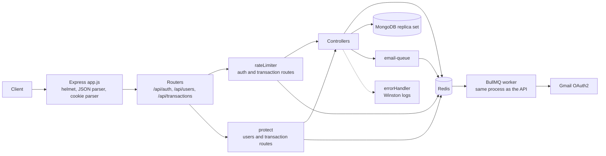
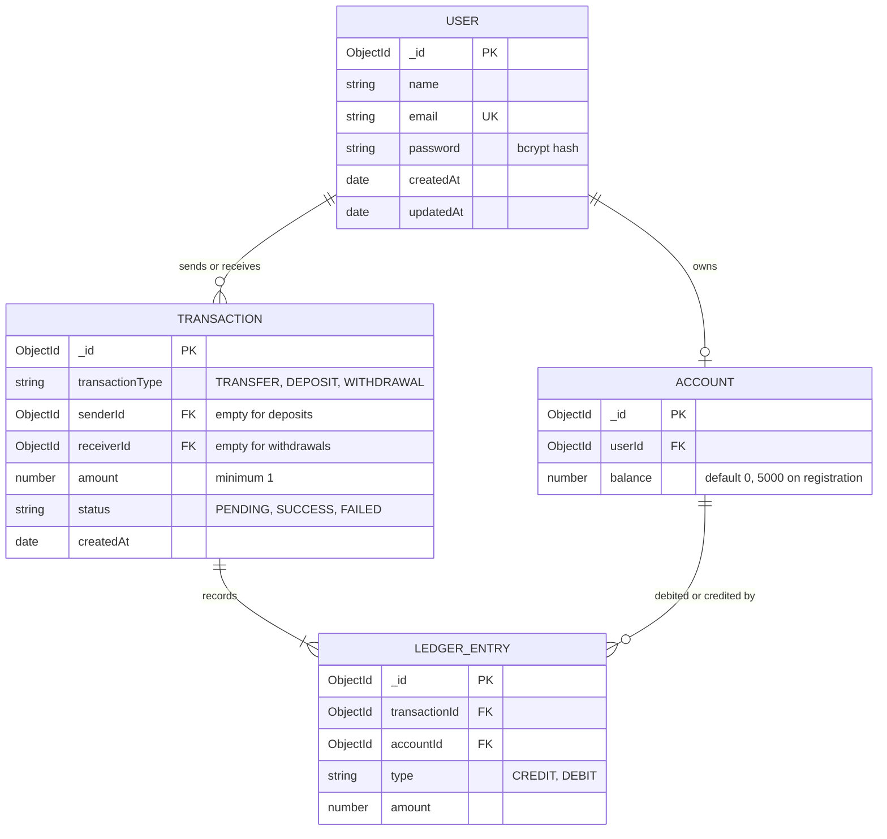
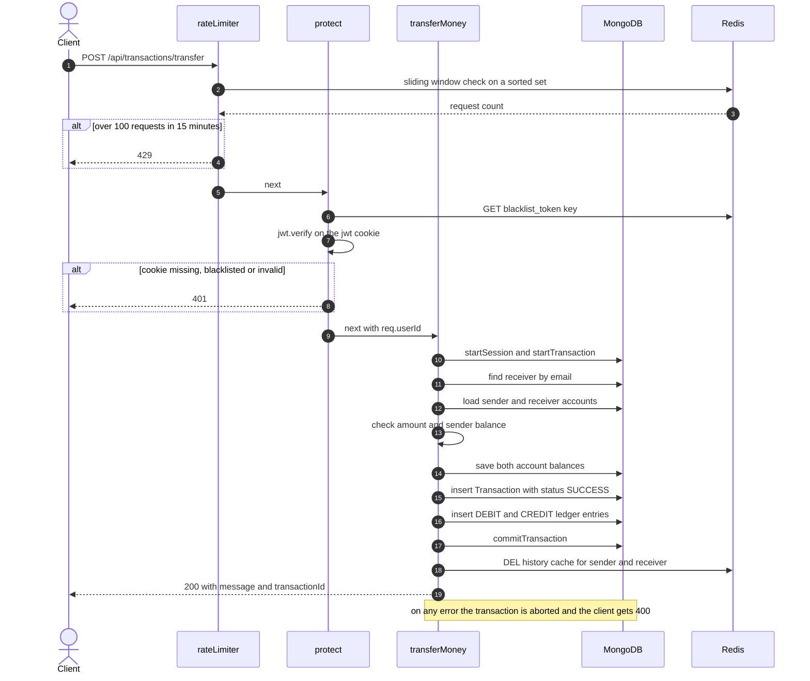
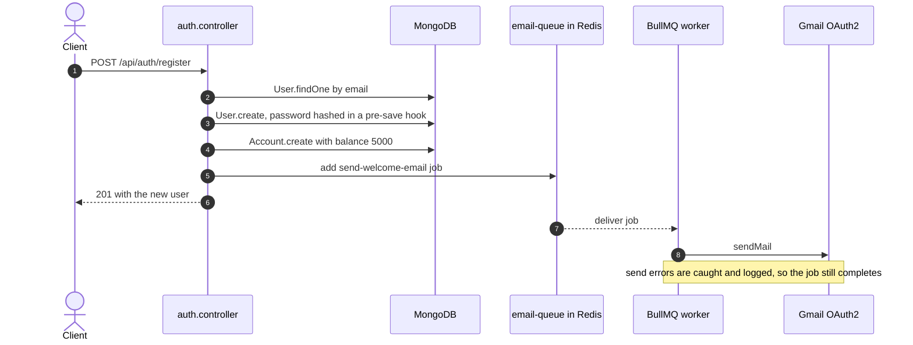

# Backend Ledger

A REST API for a small banking ledger, built with Node.js, Express, MongoDB and Redis. Users register, log in, transfer money to other users, deposit, withdraw, and page through their transaction history. Every balance change runs inside a MongoDB multi-document transaction together with the matching transaction record and ledger entries.

Redis backs three things: a sliding-window rate limiter, a JWT blacklist for logout, and a cache for transaction history. Welcome emails are queued with BullMQ and sent through Nodemailer using Gmail OAuth2.

## What the system provides

- Registration with bcrypt-hashed passwords (10 salt rounds). A new account opens with a demo balance of 5000.
- Login that sets a JWT in an `httpOnly` cookie valid for one day. The cookie is also marked `secure` when `NODE_ENV=production`.
- Logout that stores the token in Redis until it would have expired and clears the cookie. Blacklisted tokens are rejected by the auth middleware.
- Transfers between users by email, plus deposits and withdrawals. Each one commits the balance change, a transaction record, and its ledger entries atomically.
- Ledger entries typed `DEBIT` or `CREDIT`. A transfer writes one of each, a deposit writes a `CREDIT`, a withdrawal writes a `DEBIT`. The ledger schema rejects `findOneAndUpdate`.
- Paginated transaction history, cached per user in Redis and invalidated on every write.
- A rate limiter written from scratch on Redis sorted sets (sliding window): 10 requests per 15 minutes on register and login, 100 per 15 minutes on transaction routes.
- Welcome emails queued through BullMQ, so registration does not wait on the mail provider.
- A centralized error handler with typed error classes, and structured JSON logging with Winston.
- Security headers through `helmet`.

## Components

| Component | Responsibility | Default address | Notes |
|---|---|---:|---|
| Express API | Routing, auth, transfers, history, error handling | `http://localhost:3000` (`PORT`) | Entry point is `server.js` |
| MongoDB | Users, accounts, transactions, ledger entries | `MONGO_URL` | Must be a replica set, because transactions require one |
| Redis | Rate limiting, token blacklist, history cache, BullMQ queue | `127.0.0.1:6379` | Address is currently hardcoded in `utils/redisClient.js` |
| Email worker | Sends queued emails through Gmail OAuth2 | none | BullMQ worker that runs inside the API process |

### Tech stack

| Package | Used for |
|---|---|
| `express` 5 | HTTP server and routing |
| `mongoose` 9 | MongoDB models and transactions |
| `ioredis` | Redis client |
| `bullmq` | Background email queue |
| `nodemailer` | Email delivery through Gmail OAuth2 |
| `jsonwebtoken`, `bcryptjs` | Tokens and password hashing |
| `cookie-parser`, `helmet` | Cookie reading and security headers |
| `winston` | Structured logging |
| `dotenv`, `nodemon` | Configuration and development reload |

## Architecture



The rate limiter runs first on `/api/auth/register`, `/api/auth/login` and every transaction route. The `protect` middleware guards `/api/users/profile` and every transaction route. Redis is used by the limiter (sorted sets), by `protect` (blacklist lookup), by the controllers (blacklist writes and the history cache), and by BullMQ (the queue itself).

## Data model



- The balance is stored on the account document and updated in the same MongoDB transaction that writes the ledger entries.
- One account is created per user at registration. The schema does not enforce one account per user.
- Transactions are created with status `SUCCESS` by the controllers. A failed request aborts the MongoDB transaction, so no `FAILED` record is written.
- Email addresses are unique. Transaction amounts have a minimum of 1.

## Request lifecycles

### Money transfer



Deposits and withdrawals follow the same path with one account and one ledger entry. A withdrawal checks the balance first.

### Registration and the email queue



### Logout and the token blacklist

On logout the controller decodes the `jwt` cookie, computes the seconds left until it expires, and stores `blacklist_token:<token>` in Redis with that TTL. The `protect` middleware checks this key before verifying the token, so a logged-out token stops working immediately. The cookie is cleared in the same response.

### Transaction history cache

`GET /api/transactions/history` looks in the Redis hash `history:<userId>`, using the field `page:<page>:limit:<limit>`. On a miss it queries MongoDB (newest first, sender and receiver populated with name and email), stores the response, and sets a 300 second expiry on the hash. Transfers, deposits and withdrawals delete the hash for every user whose history changed.

### Rate limiter

For each request the limiter builds the key `ratelimit:<router base path>:<ip>`, then runs one Redis pipeline: remove timestamps older than the window, add the current timestamp, count the entries, and refresh the key expiry. If the count exceeds the limit, the response is `429`. Register and login share one counter because they share the `/api/auth` base path. Logout is not limited.

## HTTP API

Base URL: `http://localhost:3000`. All request bodies are JSON. Authenticated routes read the `jwt` cookie that login sets.

### Auth

| Method | Path | Purpose | Success |
|---|---|---|---|
| POST | `/api/auth/register` | Create a user, open an account, queue a welcome email | 201 |
| POST | `/api/auth/login` | Verify credentials and set the `jwt` cookie | 200 |
| POST | `/api/auth/logout` | Blacklist the token and clear the cookie | 200 |

Register request:

```json
{ "name": "Asha", "email": "asha@example.com", "password": "secret123" }
```

Register response:

```json
{
  "success": true,
  "message": "User account created! Welcome email queued in background.",
  "user": { "_id": "...", "name": "Asha", "email": "asha@example.com" }
}
```

### Users

| Method | Path | Purpose | Success |
|---|---|---|---|
| GET | `/api/users/profile` | Return the user (without the password hash) and their account | 200 |

### Transactions

All transaction routes require the cookie and are rate limited.

| Method | Path | Body | Purpose | Success |
|---|---|---|---|---|
| POST | `/api/transactions/transfer` | `receiverEmail`, `amount` | Move money to another user | 200 |
| POST | `/api/transactions/deposit` | `amount` | Add money to your account | 200 |
| POST | `/api/transactions/withdraw` | `amount` | Remove money from your account | 200 |
| GET | `/api/transactions/history?page=1&limit=10` | none | Paginated history, newest first | 200 |

Transfer request and response:

```json
{ "receiverEmail": "ravi@example.com", "amount": 500 }
```

```json
{ "message": "Success! Rs 500 transferred to Ravi", "transactionId": "..." }
```

Deposit and withdraw responses include `message`, `newBalance` and `transactionId`. `amount` must be a positive number, and the transaction schema enforces a minimum of 1. A transfer to your own email, an unknown receiver, and a balance that is too low are all rejected.

History response:

```json
{
  "message": "Transaction history fetched successfully",
  "pagination": {
    "totalRecords": 12,
    "currentPage": 1,
    "totalPages": 2,
    "hasNextPage": true,
    "hasPrevPage": false
  },
  "transactions": []
}
```

### Other routes

| Method | Path | Response |
|---|---|---|
| GET | `/` | Plain text confirmation that the API is running |
| any | unknown path | 404 with code `ROUTE_NOT_FOUND` |

## Error responses

The API currently returns two error shapes.

Errors raised through `next(error)` (the auth controller and the 404 fallback) go through the central handler:

```json
{
  "success": false,
  "error": { "code": "EMAIL_EXISTS", "message": "...", "stack": "..." }
}
```

`stack` is included outside production and omitted when `NODE_ENV=production`. Server errors (5xx) are logged at `error` level with the stack, and client errors (4xx) at `warn` level.

The auth middleware, the rate limiter, and the transaction, history and profile controllers respond directly with `{ "message": "..." }`, plus an `error` string when the controller caught an exception.

| Status | Source |
|---:|---|
| 400 | Login with an unknown email (`USER_NOT_FOUND`), or any failure inside transfer, deposit or withdraw: invalid amount, unknown receiver, insufficient balance, or a database error |
| 401 | Missing, invalid, expired or blacklisted cookie, or a wrong password (`INVALID_CREDENTIALS`) |
| 404 | Unknown route (`ROUTE_NOT_FOUND`), or a profile request for a user that no longer exists |
| 409 | Email already registered (`EMAIL_EXISTS`) |
| 429 | Rate limit exceeded |
| 500 | Unexpected errors, and failures in the profile or history handlers |

## Local setup

### Prerequisites

- Node.js 20.19 or newer (required by Mongoose 9 and its MongoDB driver).
- MongoDB running as a **replica set**. Multi-document transactions do not work on a standalone `mongod`. MongoDB Atlas works out of the box. For local development, one option is Docker:

```bash
docker run -d --name ledger-mongo -p 27017:27017 mongo:7 --replSet rs0
docker exec ledger-mongo mongosh --quiet --eval 'rs.initiate({_id:"rs0",members:[{_id:0,host:"127.0.0.1:27017"}]})'
```

- Redis on `127.0.0.1:6379`:

```bash
docker run -d --name ledger-redis -p 6379:6379 redis:7
```

- Optional: Gmail OAuth2 credentials for sending email. Without them the worker logs a send error and the API keeps working.

### Install and configure

```bash
git clone https://github.com/Satish-011/Backend-ledger.git
cd Backend-ledger
npm install
```

Create a `.env` file in the project root:

```env
PORT=3000
NODE_ENV=development
MONGO_URL=mongodb://127.0.0.1:27017/ledger?replicaSet=rs0
JWT_SECRET=change-me-to-a-long-random-string
EMAIL_USER=you@gmail.com
CLIENT_ID=your-google-oauth-client-id
CLIENT_SECRET=your-google-oauth-client-secret
REFRESH_TOKEN=your-google-oauth-refresh-token
```

### Run

```bash
npm run dev
```

This starts `server.js` with nodemon. Logs go to the console outside production, and to `logs/error.log` and `logs/combined.log` in every environment.

## Try it

The `jwt` cookie is stored in a cookie jar, so later requests are authenticated.

```bash
curl -c jar.txt -X POST http://localhost:3000/api/auth/register \
  -H "Content-Type: application/json" \
  -d '{"name":"Asha","email":"asha@example.com","password":"secret123"}'

curl -c jar.txt -X POST http://localhost:3000/api/auth/login \
  -H "Content-Type: application/json" \
  -d '{"email":"asha@example.com","password":"secret123"}'

curl -b jar.txt -X POST http://localhost:3000/api/transactions/deposit \
  -H "Content-Type: application/json" \
  -d '{"amount":500}'

curl -b jar.txt "http://localhost:3000/api/transactions/history?page=1&limit=10"

curl -b jar.txt -X POST http://localhost:3000/api/auth/logout
```

Register and login share a limit of 10 requests per 15 minutes per IP, so avoid scripting many logins in a row.

## Configuration reference

| Variable | Used by | Purpose |
|---|---|---|
| `PORT` | `server.js` | HTTP port, default `3000` |
| `NODE_ENV` | cookies, logger, error handler | `production` enables `secure` cookies, hides stack traces, and turns off console logs |
| `MONGO_URL` | `server.js` | MongoDB connection string |
| `JWT_SECRET` | auth controller and middleware | Signs and verifies tokens |
| `EMAIL_USER` | `utils/mailer.js` | Sender address |
| `CLIENT_ID`, `CLIENT_SECRET`, `REFRESH_TOKEN` | `utils/mailer.js` | Gmail OAuth2 credentials |

## Repository layout

```
Backend-ledger/
├── server.js                  # loads env, connects MongoDB, starts the server
├── app.js                     # helmet, parsers, routers, 404 fallback, error handler
├── routes/
│   ├── auth.routes.js         # register, login, logout
│   ├── user.routes.js         # profile
│   └── transaction.routes.js  # transfer, deposit, withdraw, history
├── controllers/
│   ├── auth.controller.js
│   ├── user.controller.js
│   └── transaction.controller.js
├── middlewares/
│   ├── auth.middleware.js     # cookie, blacklist check, JWT verification
│   ├── rateLimiter.js         # Redis sliding window limiter
│   └── errorHandler.js        # central error handler with Winston logging
├── models/
│   ├── user.model.js          # password hashing hook
│   ├── account.model.js
│   ├── transaction.model.js
│   └── ledger.model.js
└── utils/
    ├── error.js               # AppError and typed subclasses
    ├── logger.js              # Winston configuration
    ├── redisClient.js         # shared ioredis connection
    ├── emailQueue.js          # BullMQ queue and worker
    └── mailer.js              # Nodemailer with Gmail OAuth2
```

## Current limitations and roadmap

- Request bodies are not validated against a schema. Amounts are only checked for being positive.
- Money is stored as JavaScript numbers (floating point). Integer minor units would be safer.
- There are no idempotency keys, so a client that retries a timed-out transfer can post it twice.
- A transfer that loses a MongoDB write conflict returns 400 instead of retrying automatically.
- Redis is not optional: its address is hardcoded, and the client is configured to wait for reconnection, so requests that need Redis wait while it is down.
- The email worker runs inside the API process, and no job retries or backoff are configured.
- There are no automated tests, no Dockerfile, and no Compose file yet.
