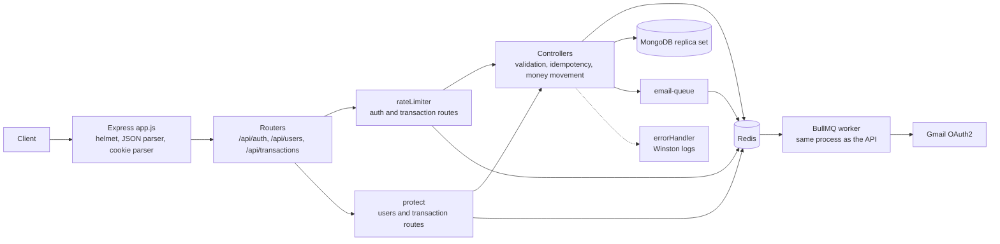
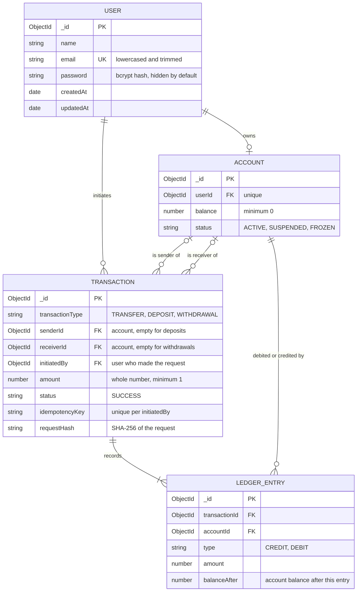
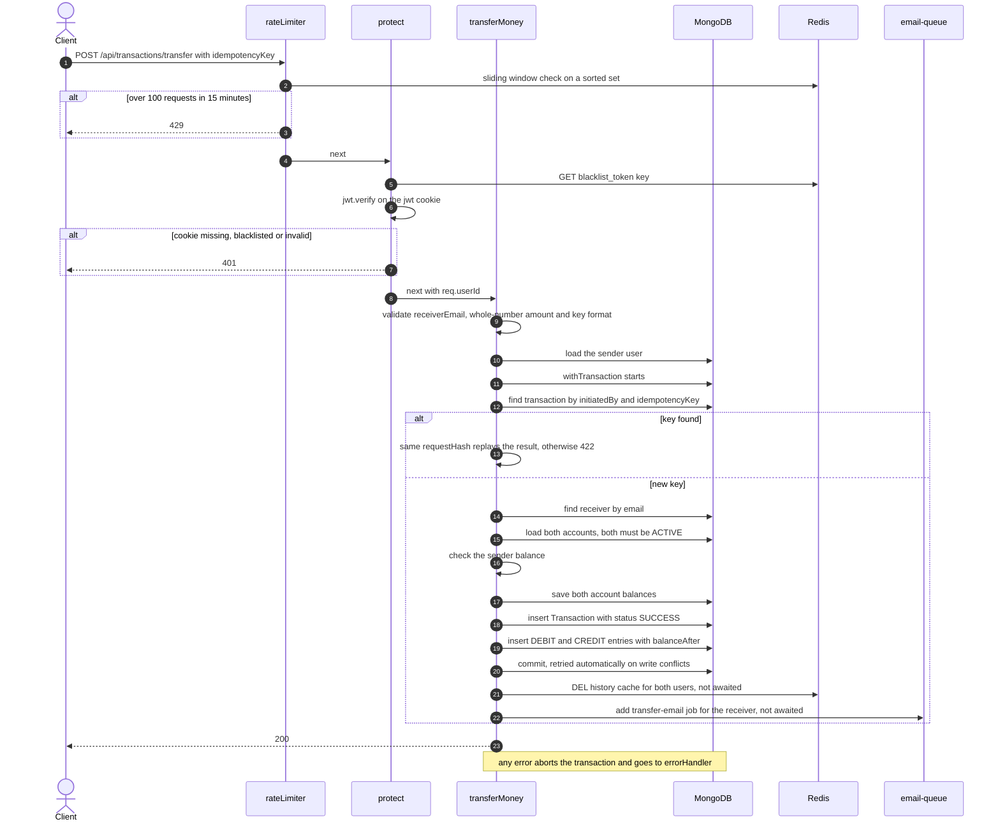
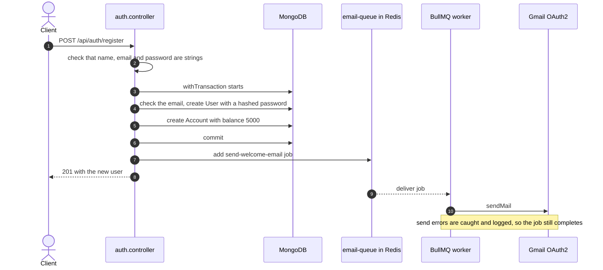

# Backend Ledger

A REST API for a small banking ledger, built with Node.js, Express, MongoDB and Redis. Users register, log in, transfer money to other users, deposit, withdraw, and page through their transaction history.

Every money movement runs inside a MongoDB multi-document transaction that updates the balances, writes the transaction record, and appends ledger entries together. Money-moving requests carry an idempotency key, so a retried request never posts twice.

Redis backs a sliding-window rate limiter, a JWT blacklist for logout, and a cache for transaction history. Emails are queued with BullMQ and sent through Nodemailer using Gmail OAuth2.

## What the system provides

- Registration with validated input and bcrypt-hashed passwords (10 salt rounds). The user and the account are created in one MongoDB transaction, so you never get a user without an account. A new account opens with a demo balance of 5000.
- Login that returns the same error for an unknown email and a wrong password, and sets a JWT in an `httpOnly` cookie valid for one day (`secure` when `NODE_ENV=production`).
- Logout that verifies the token and stores it in Redis until it would have expired, then clears the cookie.
- Transfers by email, deposits and withdrawals. Each one requires an idempotency key, uses whole-number amounts, and only works on `ACTIVE` accounts. Write conflicts between concurrent requests are retried automatically, and a balance can never go negative.
- Idempotent requests: replaying a request returns the stored result, and reusing a key with a different request is rejected.
- Ledger entries typed `DEBIT` or `CREDIT`, each storing the account balance right after it (`balanceAfter`). The ledger is append-only: updates, replaces and deletes are blocked at the model level.
- Paginated transaction history, cached per user in Redis and invalidated on every write. Counterparties appear by name and email only.
- A Redis rate limiter written from scratch on sorted sets: 10 requests per 15 minutes on register and login, 100 per 15 minutes on transaction routes.
- A welcome email on registration and a "Funds Received" email to the receiver of a transfer, both queued through BullMQ. User names are HTML-escaped in the email body.
- A centralized error handler with typed errors, structured JSON logging with Winston, and security headers through `helmet`.

## Components

| Component | Responsibility | Default address | Notes |
|---|---|---:|---|
| Express API | Routing, auth, validation, money movement, error handling | `http://localhost:3000` (`PORT`) | Entry point is `server.js` |
| MongoDB | Users, accounts, transactions, ledger entries | `MONGO_URL` | Must be a replica set, because transactions require one |
| Redis | Rate limiting, token blacklist, history cache, BullMQ queue | `127.0.0.1:6379` | Address is currently hardcoded in `utils/redisClient.js` |
| Email worker | Sends queued emails through Gmail OAuth2 | none | BullMQ worker that runs inside the API process |

### Tech stack

| Package | Used for |
|---|---|
| `express` 5 | HTTP server and routing |
| `mongoose` 9 | MongoDB models and transactions |
| `ioredis` | Redis client |
| `bullmq` | Background email queue |
| `nodemailer` | Email delivery through Gmail OAuth2 |
| `jsonwebtoken`, `bcryptjs` | Tokens and password hashing |
| `cookie-parser`, `helmet` | Cookie reading and security headers |
| `winston` | Structured logging |
| `dotenv`, `nodemon` | Configuration and development reload |

## Architecture



The rate limiter runs first on `/api/auth/register`, `/api/auth/login` and every transaction route. The `protect` middleware guards `/api/users/profile` and every transaction route. Redis is used by the limiter (sorted sets), by `protect` (blacklist lookup), by the controllers (blacklist writes and the history cache), and by BullMQ (the queue itself).

## Data model



- `senderId` and `receiverId` point to accounts, not users. A deposit has no sender and a withdrawal has no receiver. `initiatedBy` is the user who made the request.
- A transfer writes two ledger entries (a `DEBIT` on the sender's account and a `CREDIT` on the receiver's). A deposit writes one `CREDIT` and a withdrawal writes one `DEBIT`.
- The balance is stored on the account and updated in the same MongoDB transaction that writes the ledger entries. `balanceAfter` records the resulting balance on every entry.
- One account per user is enforced by a unique index on `userId`. Balances cannot go below 0.
- Transactions are only created as `SUCCESS`. A failed request aborts the MongoDB transaction, so no record is written for it.
- Amounts are whole numbers (rupees).

## Request lifecycles

### Money transfer



Deposits and withdrawals follow the same path with one account and one ledger entry.

### Registration and the email queue



If creating the account fails, the user is rolled back too.

### Idempotency

`transfer`, `deposit` and `withdraw` must carry a key, in the `idempotencyKey` body field or an `Idempotency-Key` header. It must be 8 to 100 characters of letters, digits and `. _ : -`. A random UUID works well.

- **Same key, same request:** the stored transaction is returned with status 200, `replayed: true` and an `Idempotent-Replayed: true` header. Nothing is posted again. The replay response contains `message`, `transactionId` and `replayed`.
- **Same key, different request:** rejected with 422 `IDEMPOTENCY_KEY_REUSED`. Requests are compared by a SHA-256 hash of their type, receiver email and amount.
- **Concurrent duplicates:** a unique index on `{ initiatedBy, idempotencyKey }` guarantees that only one transaction commits. The duplicates hit a write conflict, retry, find the committed transaction and replay it.
- **Failed requests:** a request that fails (for example insufficient balance) rolls back completely and does not use up its key, so the client can retry it with the same key.
- **Scope:** keys are per user, so two users can use the same key independently. Keys are stored with the transaction and do not expire.

### Ledger immutability

The ledger model rejects `updateOne`, `updateMany`, `findOneAndUpdate`, `findOneAndReplace`, `replaceOne`, `deleteOne`, `deleteMany`, `findOneAndDelete`, saving an already stored entry, and any `bulkWrite` that is not an insert. Every field is also marked `immutable`. This protects the data from mistakes in application code. A direct write through the MongoDB driver or shell is not blocked by Mongoose, so a production deployment should also use a database user with insert and read permissions only on the ledger collection.

### Logout and the token blacklist

On logout the controller verifies the `jwt` cookie, computes the seconds left until it expires, and stores `blacklist_token:<token>` in Redis with that TTL. A token that fails verification is ignored, so it cannot be used to fill Redis. The `protect` middleware checks the blacklist key before verifying the token, so a logged-out token stops working immediately. The cookie is cleared in the same response.

### Transaction history cache

`GET /api/transactions/history` looks in the Redis hash `history:<userId>`, using the field `page:<page>:limit:<limit>`. On a miss it queries MongoDB for the transactions where the user's account is the sender or the receiver (newest first), populates both parties with name and email only, stores the response, and sets a 300 second expiry on the hash. `page` is at least 1 and `limit` is between 1 and 100. Transfers, deposits and withdrawals delete the hash for every user whose history changed.

### Rate limiter

For each request the limiter builds the key `ratelimit:<router base path>:<ip>`, then runs one Redis pipeline: remove timestamps older than the window, add the current timestamp, count the entries, and refresh the key expiry. If the count exceeds the limit, the response is `429`. Register and login share one counter because they share the `/api/auth` base path. Logout is not limited.

## HTTP API

Base URL: `http://localhost:3000`. All request bodies are JSON. Authenticated routes read the `jwt` cookie that login sets.

### Auth

| Method | Path | Purpose | Success |
|---|---|---|---|
| POST | `/api/auth/register` | Create a user and an account, queue a welcome email | 201 |
| POST | `/api/auth/login` | Verify credentials and set the `jwt` cookie | 200 |
| POST | `/api/auth/logout` | Blacklist the token and clear the cookie | 200 |

Validation rules for registration: `name` is required, `email` must be a valid address (stored lowercased and trimmed), and `password` must be at least 8 characters. All three must be strings.

Register request:

```json
{ "name": "Asha", "email": "asha@example.com", "password": "secret123" }
```

Register response (201):

```json
{
  "success": true,
  "message": "User account created! Welcome email queued.",
  "user": { "_id": "...", "name": "Asha", "email": "asha@example.com" }
}
```

Login returns 401 `INVALID_CREDENTIALS` with the same message whether the email is unknown or the password is wrong.

### Users

| Method | Path | Purpose | Success |
|---|---|---|---|
| GET | `/api/users/profile` | Return the user (without the password hash) and their account | 200 |

Response:

```json
{
  "message": "Profile data fetched successfully",
  "user": { "_id": "...", "name": "Asha", "email": "asha@example.com", "createdAt": "...", "updatedAt": "..." },
  "account": { "_id": "...", "userId": "...", "balance": 5000, "status": "ACTIVE", "createdAt": "...", "updatedAt": "..." }
}
```

### Transactions

All transaction routes require the cookie and are rate limited. The three write routes also require an idempotency key.

| Method | Path | Body | Purpose | Success |
|---|---|---|---|---|
| POST | `/api/transactions/transfer` | `receiverEmail`, `amount`, `idempotencyKey` | Move money to another user | 200 |
| POST | `/api/transactions/deposit` | `amount`, `idempotencyKey` | Add money to your account | 200 |
| POST | `/api/transactions/withdraw` | `amount`, `idempotencyKey` | Remove money from your account | 200 |
| GET | `/api/transactions/history?page=1&limit=10` | none | Paginated history, newest first | 200 |

`amount` must be a whole number of at least 1. Strings, decimals, zero and negative numbers return 400 `INVALID_AMOUNT`. Both accounts involved must be `ACTIVE`. Deposits are simulated: any user can credit their own account.

Transfer request:

```http
POST /api/transactions/transfer
Content-Type: application/json

{ "receiverEmail": "ravi@example.com", "amount": 1000, "idempotencyKey": "demo-transfer-0001" }
```

Transfer response (200):

```json
{
  "message": "Success! Rs 1000 transferred to Ravi",
  "transactionId": "...",
  "replayed": false
}
```

Deposit and withdraw responses (200) also include the balance after the request:

```json
{
  "message": "Success! Rs 500 deposited.",
  "newBalance": 5500,
  "transactionId": "...",
  "replayed": false
}
```

Replay of any of the three (200, with the `Idempotent-Replayed: true` header):

```json
{
  "message": "Transaction already processed.",
  "transactionId": "...",
  "replayed": true
}
```

History response (200):

```json
{
  "message": "Transaction history fetched successfully",
  "pagination": {
    "totalRecords": 2,
    "currentPage": 1,
    "totalPages": 1,
    "hasNextPage": false,
    "hasPrevPage": false
  },
  "transactions": [
    {
      "_id": "...",
      "transactionType": "TRANSFER",
      "senderId": { "_id": "...", "userId": { "_id": "...", "name": "Asha", "email": "asha@example.com" } },
      "receiverId": { "_id": "...", "userId": { "_id": "...", "name": "Ravi", "email": "ravi@example.com" } },
      "amount": 1000,
      "idempotencyKey": "demo-transfer-0001",
      "status": "SUCCESS",
      "createdAt": "...",
      "updatedAt": "..."
    }
  ]
}
```

For a deposit `senderId` is missing, and for a withdrawal `receiverId` is missing.

### Other routes

| Method | Path | Response |
|---|---|---|
| GET | `/` | Plain text confirmation that the API is running |
| any | unknown path | 404 with code `ROUTE_NOT_FOUND` |

## Error responses

Errors from the auth controller, the transaction write routes and the 404 fallback go through the central handler:

```json
{
  "success": false,
  "error": { "code": "INSUFFICIENT_BALANCE", "message": "Insufficient balance!", "stack": "..." }
}
```

`stack` is included outside production. In production it is omitted, and the message of a 5xx error is replaced with `Internal server error`. Server errors are logged at `error` level with the stack, and client errors at `warn` level. Mongoose validation errors become 400, duplicate keys become 409, and bad ids become 400.

The auth middleware, the rate limiter, the profile handler and the history handler respond directly with `{ "message": "..." }`, plus an `error` string for the profile and history handlers when an exception was caught.

| Status | Codes |
|---:|---|
| 400 | `INVALID_INPUT`, `VALIDATION_ERROR`, `INVALID_AMOUNT`, `INVALID_IDEMPOTENCY_KEY`, `SELF_TRANSFER` |
| 401 | `INVALID_CREDENTIALS`, and a missing, invalid, expired or blacklisted cookie |
| 403 | `ACCOUNT_NOT_ACTIVE` |
| 404 | `USER_NOT_FOUND`, `RECEIVER_NOT_FOUND`, `ACCOUNT_NOT_FOUND`, `ROUTE_NOT_FOUND` |
| 409 | `EMAIL_EXISTS`, `DUPLICATE_KEY` |
| 422 | `INSUFFICIENT_BALANCE`, `IDEMPOTENCY_KEY_REUSED` |
| 429 | Rate limit exceeded |
| 500 | `SERVER_ERROR`, and failures in the profile or history handlers |

## Local setup

### Prerequisites

- Node.js 20.19 or newer (required by Mongoose 9 and its MongoDB driver).
- MongoDB running as a **replica set**. Multi-document transactions do not work on a standalone `mongod`. MongoDB Atlas works out of the box. For local development, one option is Docker:

```bash
docker run -d --name ledger-mongo -p 27017:27017 mongo:7 --replSet rs0
docker exec ledger-mongo mongosh --quiet --eval 'rs.initiate({_id:"rs0",members:[{_id:0,host:"127.0.0.1:27017"}]})'
```

- Redis on `127.0.0.1:6379`. The repository includes a Compose file that starts it:

```bash
docker compose up -d
```

- Optional: Gmail OAuth2 credentials for sending email. Without them the worker logs a send error and the API keeps working.

### Install and configure

```bash
git clone https://github.com/Satish-011/Backend-ledger.git
cd Backend-ledger
npm install
```

Create a `.env` file in the project root:

```env
PORT=3000
NODE_ENV=development
MONGO_URL=mongodb://127.0.0.1:27017/ledger?replicaSet=rs0
JWT_SECRET=change-me-to-a-long-random-string
EMAIL_USER=you@gmail.com
CLIENT_ID=your-google-oauth-client-id
CLIENT_SECRET=your-google-oauth-client-secret
REFRESH_TOKEN=your-google-oauth-refresh-token
```

### Run

```bash
npm run dev
```

This starts `server.js` with nodemon (`npm start` runs it with plain Node). The server exits with code 1 if it cannot connect to MongoDB. Logs go to the console outside production, and to `logs/error.log` and `logs/combined.log` in every environment.

If you are upgrading a database that was created by an earlier version of this project, drop it first. The transaction collection now has a different unique index for idempotency keys, and older transactions have no keys.

## Try it

The `jwt` cookie is stored in a cookie jar, so later requests are authenticated. Reuse the same `idempotencyKey` to see a replay.

```bash
curl -c jar.txt -X POST http://localhost:3000/api/auth/register \
  -H "Content-Type: application/json" \
  -d '{"name":"Asha","email":"asha@example.com","password":"secret123"}'

curl -c jar.txt -X POST http://localhost:3000/api/auth/login \
  -H "Content-Type: application/json" \
  -d '{"email":"asha@example.com","password":"secret123"}'

curl -i -b jar.txt -X POST http://localhost:3000/api/transactions/deposit \
  -H "Content-Type: application/json" \
  -d '{"amount":500,"idempotencyKey":"demo-deposit-0001"}'

curl -i -b jar.txt -X POST http://localhost:3000/api/transactions/deposit \
  -H "Content-Type: application/json" \
  -d '{"amount":500,"idempotencyKey":"demo-deposit-0001"}'

curl -b jar.txt "http://localhost:3000/api/transactions/history?page=1&limit=10"

curl -b jar.txt -X POST http://localhost:3000/api/auth/logout
```

The second deposit returns the same `transactionId` with `replayed: true`, and the balance changes only once. Register and login share a limit of 10 requests per 15 minutes per IP, so avoid scripting many logins in a row.

## Configuration reference

| Variable | Used by | Purpose |
|---|---|---|
| `PORT` | `server.js` | HTTP port, default `3000` |
| `NODE_ENV` | cookies, logger, error handler | `production` enables `secure` cookies, hides stack traces and 5xx messages, and turns off console logs |
| `MONGO_URL` | `server.js` | MongoDB connection string |
| `JWT_SECRET` | auth controller and middleware | Signs and verifies tokens |
| `EMAIL_USER` | `utils/mailer.js` | Sender address |
| `CLIENT_ID`, `CLIENT_SECRET`, `REFRESH_TOKEN` | `utils/mailer.js` | Gmail OAuth2 credentials |

## Repository layout

```
Backend-ledger/
├── server.js                  # connects MongoDB, then starts the server
├── app.js                     # helmet, parsers, routers, 404 fallback, error handler
├── docker-compose.yml         # Redis for local development
├── routes/
│   ├── auth.routes.js         # register, login, logout
│   ├── user.routes.js         # profile
│   └── transaction.routes.js  # transfer, deposit, withdraw, history
├── controllers/
│   ├── auth.controller.js     # registration transaction, login, logout
│   ├── user.controller.js
│   └── transaction.controller.js  # validation, idempotency, money movement, history
├── middlewares/
│   ├── auth.middleware.js     # cookie, blacklist check, JWT verification
│   ├── rateLimiter.js         # Redis sliding window limiter
│   └── errorHandler.js        # central error handler with Winston logging
├── models/
│   ├── user.model.js          # validation and password hashing
│   ├── account.model.js       # balance and status
│   ├── transaction.model.js   # idempotency fields and indexes
│   └── ledger.model.js        # append-only entries
└── utils/
    ├── error.js               # AppError and typed subclasses
    ├── escapeHtml.js          # escapes user names in email HTML
    ├── logger.js              # Winston configuration
    ├── redisClient.js         # shared ioredis connection
    ├── emailQueue.js          # BullMQ queue and worker
    └── mailer.js              # Nodemailer with Gmail OAuth2
```

## Current limitations and roadmap

- Deposits, withdrawals and the signup bonus have no counterpart ledger entry, because there is no system account. Account balances therefore do not add up to zero, and there is no command that reconciles stored balances against the ledger. The signup bonus is written straight to the balance and has no ledger entry.
- Amounts are whole rupees, and accounts have no currency. Integer minor units (paise) would allow fractional amounts.
- Ledger immutability is enforced in the application only. Production should also restrict the database user.
- There is no admin API to change an account's `status`, so it is edited directly in the database.
- Redis is not optional: its address is hardcoded, and the client is configured to wait for reconnection, so requests that need Redis wait while it is down.
- The rate limiter is approximate under bursts: entries are keyed by millisecond timestamp, so requests in the same millisecond count once.
- The email worker runs inside the API process. Send errors are caught and logged, so a failed email is not retried.
- There are no automated tests yet. Jest and Supertest are installed, but no test files exist.
- The Compose file starts Redis only, and there is no Dockerfile for the API.
